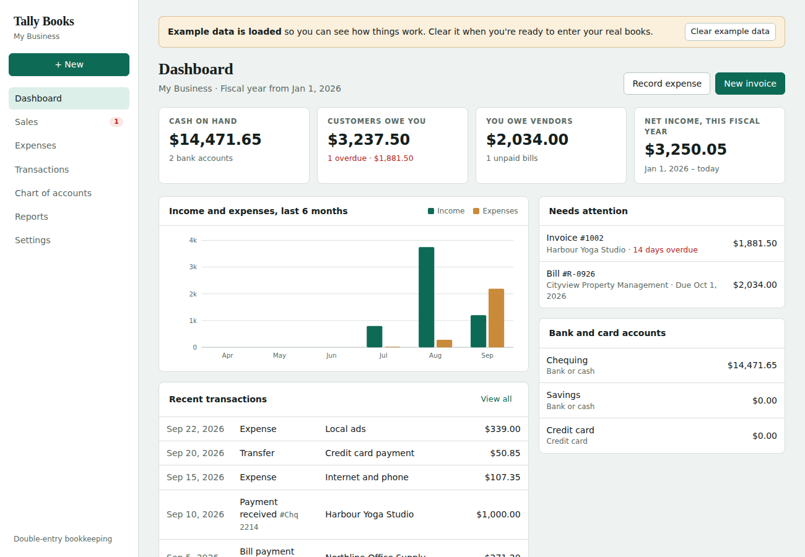

# Sumlora

*Formerly Tally Books.* Copies installed under the old name update to Sumlora by themselves and keep their books, backups, licence and settings: the app keeps using its existing folders, and nothing needs to be moved. Logo files (SVG and PNG) are in [`brand/`](brand/).

Double-entry bookkeeping for small businesses. Send invoices, enter bills and expenses, keep a chart of accounts, and run the reports an accountant needs at year-end.

It runs two ways from the same code:

- **Web app:** a small server you run on your computer or a server, then open in any browser. Several people can use it at once, and changes show up live for everyone.
- **Desktop app:** an installable app for Windows, macOS and Linux. It keeps your books in a file on your own computer.



## Features

- **Multiple companies:** keep books for any number of clients. A client list shows each company's bank lines waiting for review, overdue invoices, receivables and when it was last reconciled. Switch between companies from the sidebar.
  - Each company is a separate database file, so books never mix, and a backup covers one client.
  - **Type of business:** a new company can start with the accounts its industry needs on top of the standard chart: restaurant, café or bar; pizza or take-out; convenience store or gas bar; retail store; online store; painting contractor; construction or renovation; electrician, plumber or HVAC; cleaning or landscaping; trucking; salon, spa or barber; consulting; rental property; scrap yard or auto recycler (which also turns on the Scrap yard add-on, below). For example a restaurant gets food and beverage sales, delivery app sales and commissions, food and beverage cost, kitchen equipment, gift cards and tips payable. Existing books can add an industry's accounts any time from Chart of accounts (only the missing ones are added).
  - New companies get the right sales tax for their province or territory: 13% HST in Ontario, 14% in Nova Scotia, 15% in New Brunswick, Newfoundland and Labrador, and PEI, combined GST/QST in Quebec, and 5% GST elsewhere. You can also set the rate yourself.
  - You pick the fiscal year-end, and can copy the chart of accounts from another client.
  - Archive former clients to hide them without deleting anything.
- **Sales:** invoices with line items and sales tax, partial and full payments, and a status on every invoice (open, partial, overdue, paid).
  - **Batch actions:** tick invoices, credit notes and sales receipts on the Sales list (or all of them) and send them all by email, download them as one PDF, send reminders for the overdue ones, or mark invoices as sent. Emails go one at a time with a progress count; one that fails doesn't stop the rest, and a summary lists what was sent, skipped (no email address) and failed, with the reason. Bills have no PDF, so Expenses has no batch actions.
- **Expenses:** vendor bills, bill payments, expenses paid by bank or credit card, and deposits.
- **Banking:** transfers between accounts, credit card payments, and a register for each account with a running balance.
- **Bank statement import:** import CSV, OFX, QFX or QBO files downloaded from online banking, including headerless CSVs like TD's and CIBC's. Lines already imported are skipped, so date ranges can overlap.
- **For review:** each imported line gets a suggestion before it's added:
  - a match with an existing transaction;
  - a payment for an open invoice or bill;
  - a category from a bank rule, or the category used last time for that payee.

  You can add lines one at a time or in bulk, exclude duplicates, and undo anything.
- **Bank rules:** "when the description contains ROGERS, suggest Telephone and internet, HST included."
- **Reconciliation:** enter the statement's ending balance and date, then tick transactions until the difference is zero. You can save and come back later, and undo the most recent reconciliation. Registers mark each line C (cleared) or R (reconciled).
- **Sales tax returns:** a worksheet for each filing period (monthly, quarterly or annual, following the fiscal year) with the figures to enter in the return.
  - **Tax codes:** every invoice, bill, expense and deposit line is **HST/GST**, **Zero-rated in Canada**, **Zero-rated export**, **Exempt** or **No tax**. A customer or vendor can have a default code; for example, a US customer set to Zero-rated export fills that code in automatically on their invoices.
  - **GST/HST (CRA):** lines 90 and 91 split sales into taxable sales in Canada and exempt supplies, zero-rated exports and other revenue, with a breakdown under line 91. Lines 101 to 113C and 114/115 follow. Tax collected, input tax credits, adjustments from journal entries, and instalments are calculated from the books, and you can open the transactions behind each figure. Rebates and self-assessed amounts (lines 111, 205 and 405) are typed in.
  - **QST (Revenu Québec):** Quebec companies track GST (5%) and QST (9.975%) in separate accounts and get their own QST worksheet, lines 203 to 213.
  - **PST (British Columbia, Saskatchewan) and RST (Manitoba):** turn it on in Settings with the rate (7% BC and Manitoba, 6% Saskatchewan) and how often the return is filed (monthly, quarterly, every six months or annual). Invoices charge GST and PST separately; PST collected goes to its own *PST payable* (or *RST payable*) account. The tax code *GST only* is for items with no PST, such as most services. PST paid on bills, expenses and bank lines can't be claimed back, so it's added to the cost of the expense; only the GST goes to the GST account. The PST worksheet shows taxable sales, PST collected, adjustments, PST self-assessed on your own purchases (line D) and the commission (line F); filing posts D to an expense and F to income so the account matches the return. Returns are due at the end of the next month in BC and on the 20th in Saskatchewan and Manitoba. File them on eTaxBC, Saskatchewan Taxpayer Access Point or Manitoba TAXcess.
  - **Quick Method:** turn it on from the Sales tax page with the date you start, whether the business mostly provides services or buys goods to resell, and the 1% credit. The remittance rate is filled in from CRA's guide (RC4058) and Revenu Québec's rates: GST/HST 3.6% (services) or 1.8% (goods) at 5%, 8.8% or 4.4% in Ontario (13%), 9.4% or 4.7% in Nova Scotia (14%), 10% or 5% at 15%, and QST 6.6% or 3.4%. Any rate can be typed in. The worksheet works out sales including tax (line 101), the tax to remit (103), credits on capital purchases only (106, for accounts marked *Capital asset*) and the 1% credit on the first $30,000 of the fiscal year (107; $31,421 for QST). It shows the tax kept as income and the tax on expenses that isn't claimed. Selling a capital asset remits its tax in full (line 104). A return keeps the method it was filed with, even if the setting changes later. Filing posts an adjustment that moves those to *Sales tax Quick Method gain* and *Sales tax paid on expenses (Quick Method)*, so the tax account matches the return. A warning appears if sales including tax go over $400,000 in 12 months.
  - **Non-profits and charities:** set the organization type in Settings (business, non-profit organization or registered charity).
    - Registered charities use CRA's and Revenu Québec's net tax calculation: 60% of the GST/HST or QST charged is remitted (100% on sales of capital property), credits are claimed only on capital property, and the rest of the tax paid gets the public service bodies' rebate. A charity that elected out (GST488 / FP-2488) can switch to the regular method.
    - Other non-profits use the regular method, with credits on the share of purchases used in taxable activities. Qualifying non-profits (40% or more of revenue from government funding) and charities get the public service bodies' rebate: 50% of the GST or federal part of the HST, 82% of the provincial part in Ontario and 50% in New Brunswick, Newfoundland and Labrador, Nova Scotia and PEI, and 50% of the QST. It's included on line 111 (211 for QST); claim it with form GST66 (FP-2066 in Quebec).
    - Filing posts the tax a charity keeps to income and the tax that isn't recovered to an expense, so the tax account matches the return. Charities and qualifying non-profits can't turn on the Quick Method.
    - Reports use non-profit names: statement of operations, statement of financial position, revenue, excess of revenue over expenses and net assets. New non-profit companies start with a non-profit chart of accounts (donations, grants, membership fees, fundraising, net assets).
  - **Filing:** marking a return as filed saves its figures and can record the payment to the government, or the refund, which clears the tax account. Instalments can be recorded too.
  - **Filed periods:** changing a transaction in a filed period asks for confirmation first, and the worksheet shows when the books no longer match what was filed.
  - The app produces the figures; returns are still submitted on CRA My Business Account or with Revenu Québec.
- **Payroll (Canada, including Quebec):** pay employees and track what's owed to CRA and Revenu Québec.
  - **Employees:** province of employment, pay schedule (weekly, every 2 weeks, twice a month, monthly), salary or hourly rate, TD1 and TP-1015.3 claim amounts, extra tax, RRSP and union dues at source, CPP/QPP, EI and QPIP exemptions, and amounts paid earlier in the year outside Sumlora.
  - **Pay runs** calculate CPP, CPP2, EI and federal and provincial income tax for every province and territory, and QPP, QPP2, QPIP, Quebec EI and Quebec income tax for Quebec, using CRA's *Payroll Deductions Formulas* (T4127, 123rd edition, July 2026). Employer CPP/QPP, EI (1.4×), QPIP and the Quebec Health Services Fund are included. Yearly maximums are tracked from year-to-date amounts.
  - Every amount can be changed before posting. Changed amounts are marked "Edited" on the pay run.
  - Posting a pay run records one journal entry: wages and employer contributions as expenses, source deductions as liabilities to CRA and Revenu Québec, and net pay out of the bank. Payroll accounts (2300, 2310, 2320, 2330, 7110) are added the first time they're needed.
  - **Pay stubs** with this-pay and year-to-date amounts, printed one at a time or all together, or **emailed**: **Email pay stubs** on a posted pay run (or **Email stub** for one employee) sends each employee with an email address their stub as a PDF from the company's own mailbox, one at a time, in the employee's language (English or French, set on the employee; the company's by default), with a subject and message set in Settings → Payroll. A stub never shows the SIN, and a direct deposit account only as its last 3 digits. The pay run shows when each stub was sent; a summary lists what was sent, skipped (no email) and failed.
  - **Remittances:** what's owed to each agency per remitting period, the due date, the figures for the PD7A voucher and for Revenu Québec, and payments that clear the liability. CRA frequencies: monthly (regular), quarterly, accelerated threshold 1 (1st–15th due the 25th, 16th–end due the 10th of the next month) and threshold 2 (four periods a month, each due 3 working days after it ends). Revenu Québec has its own setting (monthly, quarterly, twice a month, weekly or yearly; the same as CRA's by default). Due dates on a weekend or public holiday move to the next business day (CRA's list of public holidays; Revenu Québec's closing days). A payment keeps the period it was recorded for, so changing frequency mid-year doesn't unmatch it.
  - **Vacation pay:** for each employee, set it aside each pay (posted to *Vacation pay payable*, 2330) and pay it out when they take vacation or leave, add it to every pay, or let a salary continue during vacation. The rate defaults to the provincial minimum for the employee's years of service (for example Ontario 4%, then 6% after 5 years; Quebec 6% after 3 years) and can be set by hand. It's worked out on regular, holiday, overtime and other pay, and on bonuses ticked as non-discretionary (a bonus is left out unless ticked). Ontario holiday pay counts the vacation pay paid with the current pay too. Pay stubs show what's owed, and the employee list shows each balance.
  - **Bonuses, allowances and taxable benefits:** a bonus is taxed with CRA's method for non-periodic payments (the year's tax with the bonus minus the year's tax without it; a flat 15%, or 10% federal and 7% Quebec, when the year's income is $5,000 or less), not annualized like regular pay. Taxable allowances are paid with the pay. Taxable benefits not paid in cash (group term life insurance, automobile, gift cards, board and lodging, other) are added to taxable income and CPP/QPP and QPIP earnings, and to EI earnings only for gift cards and board and lodging. They show on the pay stub and go on the T4 (box 14 and codes 30, 34 and 40) and RL-1 (box A and boxes L, V and W).
  - **Statutory holiday pay:** each province's public holidays are built in. When one falls in an hourly employee's pay period, the pay run suggests holiday pay at 1/20 of what they earned in the 4 weeks before the holiday's week (the Ontario and Quebec rule; Ontario adds vacation pay paid). Salaried pay already covers holidays. Every amount can be changed.
  - **Overtime:** hourly employees (and salaried ones marked eligible) enter hours by work week; hours over the weekly threshold (44 in Ontario, 40 in Quebec, each province's rule, or the company's own) are paid at 1.5 times the regular rate and shown on the pay stub. Provinces with a daily overtime rule get a reminder to check it.
  - **Workers' compensation (WSIB):** rate groups with a rate per $100, the year's maximum insurable earnings and the reporting frequency are set in Settings → Payroll. Each pay run posts the employer's premium (to Workers' compensation payable), and Remittances shows insurable earnings and premium by rate group for each period, with WSIB's due date. Other provinces enter their own board's rates.
  - **Ontario Employer Health Tax:** Year-end shows total Ontario remuneration, the $1,000,000 exemption (or an associated group's share), the rate from the tiered table, monthly instalments when remuneration is over $1,200,000 (due the 15th, or the next business day when that is a weekend or Ontario holiday) and the March 15 return, and can record monthly accrual entries.
  - **Void a pay run:** posts a reversing entry on the date you choose and marks the run void, so it's left out of year-to-date amounts, remittances, WSIB, EHT, T4s and the T4 XML, ROEs and the ROE XML, the cash flow forecast's next pay, workflow reminders and the Payroll add-on's employees billed, and its stubs aren't emailed. Later pay runs that used it are listed, and the next pay run catches up CPP and EI. Only the latest pay run, with nothing reconciled, can still be deleted.
  - **Records of employment (ROE):** mark an employee's final pay (it pays out the vacation pay owed), then open **Record of employment** on their page. Sumlora fills in every block: pay period type, dates, insurable hours (15A), insurable earnings for each of the last 27 pay periods (15C, for every 2 weeks), the reason code, vacation pay on leaving (17A), statutory holiday pay and other money. It shows the due date (5 days after the final pay period), prints a worksheet to enter in Service Canada's ROE Web, and makes the ROE Web XML file. Only pay since the employee's previous ROE is counted. Saving it keeps the ROE and its serial number with the employee.
  - **Year-end (T4 and RL-1):** a T4 for every employee (one per province they worked in), an RL-1 for Quebec employees, the T4 Summary and the RL-1 Summary, built from the year's pay runs, amounts paid earlier outside Sumlora, and recorded remittances. It covers boxes 14 to 56 (including CPP2/QPP2 in 16A/17A, RPP box 20 with registration number 50 and pension adjustment 52, exemptions in 28, and dental benefits in 45) and RL-1 boxes A to I, plus the T4 codes and RL-1 boxes for taxable benefits. Yearly maximums for insurable and pensionable earnings are shared across an employee's slips in date order. The Health Services Fund rate is set from total payroll (all provinces, plus associated employers) and applied to Quebec payroll, and the labour standards contribution is worked out too. Checks flag a missing or invalid SIN, a missing dental code or pension adjustment, and deductions that don't match what CRA's year-end review expects. Export the figures to CSV or print worksheets.
  - **Electronic filing files:** *Download T4 XML* makes the T619 transmittal, T4 slips and T4 Summary as one XML file for CRA's Internet file transfer (My Business Account or Represent a Client), after checking the BN, SINs, dental codes, the contact and the addresses. *Download ROE XML* makes Service Canada's ROE Web payroll file (version W-2.0) for one record of employment or several, which arrive in ROE Web as drafts to check and submit. Employee addresses are entered in parts (street, city, province, postal code) for both. Test-submit the first file of each kind before relying on it.
  - Sumlora prepares the figures; you file them with CRA's Internet file transfer or T4 Web Forms and Revenu Québec's My Account for businesses. Revenu Québec accepts printed RL-1 slips only from certified software, so the printouts are worksheets, not slips.
  - Rates are loaded for pay dates from July 1 to December 31, 2026. Quebec income tax follows Revenu Québec's TP-1015.F method but hasn't been checked line by line against WebRAS yet, so compare a first pay run with WebRAS. Always check unusual cases against CRA's PDOC.
- **AI suggestions (optional, suggestions only):** with a Claude API key, AI suggests a category, payee and sales tax for bank lines that rules and past choices don't cover, and reads a receipt or supplier invoice (photo or PDF) into a draft expense or bill. Nothing is added to the books until someone reviews it and clicks Add or Save. It's switched on per company; an owner sets the key, the model (Claude Haiku 4.5 or Sonnet 5.5) and a monthly spending limit in Settings. The key stays on the server and is never sent to the browser; it can also be set with the `ANTHROPIC_API_KEY` environment variable. What's sent to Anthropic: each bank line's date, description and amount (or the receipt), the company's chart of accounts and payee names. Typical cost is well under a cent per bank line and about a cent per receipt.
- **AI assistant (add-on):** an **Ask AI** button where people working in a company's books ask questions in plain words ("What did we spend on fuel this year?", "Who owes us money?") and get the answer with links to the report or account it came from. It's an add-on, not part of either plan: it's off for every company until an owner ticks **Add the AI assistant to this company** in that company's **Settings**, and companies without it show no button and send nothing. It can only read the books: Claude picks one of eight read-only tools (profit and loss, balance sheet, account balances, an account's activity, transaction search, totals by vendor or customer, open invoices and bills, contact look-up), Sumlora works out the numbers the same way the reports do, and Claude explains them. Each company gets a number of questions a month (100 unless the administrator changes it in the AI settings); each question usually costs a few cents of API use. What's sent to Anthropic: the company's chart of accounts, the question and the earlier messages in the conversation, and the totals or transactions the tools return. On a server that takes subscriptions, the add-on is billed per company per month ($5 unless the administrator changes it): a firm's subscription gets an add-on line for the companies it pays for that have the assistant, and a client who pays for their own company gets it on theirs. Your own firm doesn't pay, and the desktop app has no add-on charge.
- **Scrap yard (add-on):** for scrap yards and auto recyclers. It's turned on when a company is set up with the type of business *Scrap yard or auto recycler* (the box can be unticked), or by an owner in **Settings**, and billed per company per month like the AI assistant ($10 unless the administrator changes it; your own firm doesn't pay).
  - **Set-up:** scrap metal, used parts, catalytic converter and whole-vehicle sales; *Vehicles in yard* (inventory); tow trucks and yard equipment; cost of vehicles processed, scrap bought by weight, towing and environmental disposal. Products for steel by the tonne, aluminum and copper by the pound, batteries and catalytic converters each (the quantity on an invoice is the weight), and a **Weigh ticket no.** field on invoices and sales receipts.
  - **Buy a vehicle:** stock number, VIN (with a check that it's 17 characters, has no I, O or Q, has a valid check digit, and isn't already in the yard), year, make, model, plate and ownership number. Bought from a business (a vendor) or a member of the public, with the seller's name, address, phone and photo ID. GST/HST is claimed only when the seller charged it (their number is needed). Saving posts the purchase: the price into *Vehicles in yard*, paid from the bank, cash or card. **Print purchase voucher** prints a bill of sale for the seller to sign.
  - **Profit per vehicle:** invoices, sales receipts, bills, expenses and journal entries can be pointed at a vehicle, like a project. Each vehicle shows what was paid for it, its other costs (towing, disposal), its income (parts, scrap, a whole-car sale) and the profit. **Mark finished** (crushed or sold whole) moves its cost from *Vehicles in yard* to cost of goods sold; the list shows when the inventory account and the vehicles in the yard don't agree.
  - **Parts pulled** from each car, with a bin and an asking price; **Sell** makes a sales receipt (to a walk-in customer) pointed at the vehicle and marks the part sold.
  - **Environmental checklist** for each car: fluids, battery, refrigerant, mercury switches, tires, airbags, with who ticked it and when.
  - **Bought from the public:** every vehicle bought from a person in a date range, with the seller's ID, for the municipality or an inspector, and as CSV. Seller ID numbers are masked in the activity log.
- **Receipts from a phone:** clients (or you) open Sumlora on a phone, tap **Take a photo of a receipt**, and it goes to that company's Receipts inbox. Photos are made smaller before they're sent. If AI suggestions are on, each receipt is read in the background (up to 100 a day per company) and matched to a transaction already in the books, a bank line waiting for review, or an unpaid bill. The bookkeeper approves each one: attach it, or record it as an expense or bill (matching the bank line in the same step). The photo stays with the transaction as proof (**View receipt**). Clients can add a note or remove a receipt until it's been recorded; after that it's kept. Add Sumlora to the phone's home screen and it opens like an app. Photos are kept in each company's database; automatic backups copy each one once into a `Receipts` folder beside the dated backups (and off-site), since the daily backup files don't include them.
- **Receipts by email (Thrive plan):** like QuickBooks Online's receipt forwarding, each company gets its own address (`r-<random>@<your inbound domain>`), shown with a **Copy** button under **Settings → Receipts by email** and on the Receipts screen. PDF, JPEG, PNG, WebP and HEIC attachments emailed there land in that company's Receipts inbox and are read by AI if it's on, just like phone photos; an email with no attachment is kept as a PDF of its text. Each receipt shows who sent it and the subject, and the activity log says "Receipt emailed in from …". **Make a new address** stops the old one at once. An optional list of allowed senders (addresses, or `@domain.com`) refuses everyone else; refusals are listed in the same panel.
  - A server can't receive email by itself, so a mail service does: **Postmark** (inbound JSON) or **SendGrid** (Inbound Parse, the default form). The server's administrator enters the domain under **Settings → Receipts by email (server)**, turns it on, and pastes the webhook address shown there (`https://<server>/api/inbound/email/<secret>`) into the mail service, with short steps for each. The secret is generated, checked in constant time, and can be replaced; the settings and every company's address are kept in `inbound.json` with the server's other private settings.
  - Limits: 10 MB per file, 25 MB per email, 10 files per email, 60 emails per company per hour, and the Receipts screen's 300 a day. Files are recognized by their first bytes, so only real PDFs and photos are kept; small inline pictures (signature logos) are skipped. Emails to a company whose plan doesn't include the feature, or that switched it off, are refused.
- **Bring a client over from QuickBooks Online or Sage:** a wizard (Companies → *Bring over from QuickBooks or Sage*, or Settings) reads the reports exported from QuickBooks Online, Sage 50 or Sage Accounting (Excel .xlsx, CSV, or a .zip of them): the chart of accounts, customer and vendor lists, the trial balance, open invoices and unpaid bills, and optionally the Journal report for this year's transactions. It recognises each report, works out each account's type (bank, credit card, A/R, A/P, sales tax…) for you to check, keeps the client's account numbers, and checks that the trial balance balances, that open invoices and bills agree with A/R and A/P, and that the history starts after the trial balance date. Opening balances come in as one journal entry; open invoices and bills come in as items you can receive and make payments against; everything is imported in one go or not at all, with a copy of the books kept on the server first.
- **Import data from a spreadsheet:** like QuickBooks Online's Import data. **Settings → Import data**, **+ New → Import data**, or the **Import** button on the customer, vendor, product, invoice, bill, chart of accounts and transaction lists. Customers, vendors, products and services, inventory items, the chart of accounts, invoices, sales receipts, credit notes, bills, vendor credits and journal entries, from CSV or Excel (.xlsx).
  - **Sales receipts** go into the *Deposit to* account (the first bank account when the column is left out); **credit notes** and **vendor credits** stay available until they're used on an invoice or bill, or refunded. Ones with no number get the next SR- or CN- number, as on the forms.
  - **Inventory items (Thrive):** name, SKU, price, cost, quantity on hand, total value (quantity × cost when left out) and the *As of* date, the income, inventory asset and cost of goods sold accounts (the first of each when left out), reorder point and tax code. The quantity and value are the item's starting stock, saved the same way as on the product form.
  - **Tags and classes:** every transaction import takes a **Tags** column (several names with commas or semicolons between; *Event: Spring fair* for a tag in a group) and a **Class** column for each line. Names the books don't have are a row problem, unless **Add new tags** or **Add new classes** is ticked: then they're added to Settings → Tags and Classes with the import (only those a good row uses; adding classes needs Accounting with a custom role).
  - Columns are matched from their headings in English or French (Name/Nom, Email/Courriel, Amount/Montant, Date…, and QuickBooks' own import headings); change any match before importing. A template CSV for each kind, with examples, is one click away.
  - Every row is checked before anything is added: missing names, bad dates, unknown accounts, customers, vendors or products, unknown tax codes, journal entries that don't balance, and duplicates. Rows with problems are listed with the reason and left out; they can be downloaded as a CSV to fix and import again.
  - Invoices and bills: one row per line; rows with the same number (and vendor, for bills) are one document, posted exactly as the form posts it. Each line's tax code (HST, GST, QST, Zero-rated, Exempt, None…) is matched to the company's own codes. New customers or vendors are added only when you tick the box. Journal entries are grouped by journal number and must balance.
  - Dates can be YYYY-MM-DD, DD/MM/YYYY or MM/DD/YYYY (you're asked which when a file could be either), or Excel dates.
  - Nothing already in the books is changed: records with the same name or number are skipped and reported. The closing date and filed sales tax periods are respected as in the forms, and everything comes in together, or nothing does.
- **Light or dark:** each person chooses Automatic (follows the computer), Light or Dark, in the sidebar, on the sign-in screen or under Account. The choice is saved on their account, so it follows them to other computers.
- **Classes** (or locations, departments, divisions): sort income and expenses by branch or line of business and see the profit and loss for each side by side. One per transaction, or with **Track classes on each line** (Settings → Classes, like QuickBooks Online) one on each line of an invoice, bill, sales receipt, credit, expense, deposit or journal entry, so one bill can be split between two stores. The class at the top fills every line. Sales tax, A/R, A/P and the bank side carry no line class, so the profit and loss by class still adds up to the whole. Turning the setting off keeps the classes already on lines.
- **Tags:** labels to follow an event, a campaign or a job, like QuickBooks Online's tags. Put several on an invoice, bill, sales receipt, credit, expense, deposit, journal entry or bank line (unlike a class, which goes on a transaction or a line). Tags can be in groups (group *Event*: *Trade show*, *Open house*).
  - **Settings → Tags:** add, rename, move into a group, or remove. A tag still on transactions comes off all of them first, after a confirmation; the transactions themselves don't change. On any form, type in the Tags box to find a tag, or press Enter to add a new one (type *Event: Spring fair* to put it in the Event group).
  - **Bank lines and rules:** pick tags on each line waiting for review; a bank rule can add tags, and a line from the same payee suggests the tags used last time.
  - Tags show as small labels on the Sales and Expenses lists, Transactions, account registers and the bank lines already added. The Transactions page and the reports' **Filter** (below) can show only the transactions with chosen tags.
  - **Money in and out by tag** (Reports → Tags): income, expenses and the net for each tag over a period, on the accrual or cash basis, with CSV and PDF. Click a tag to see its transactions. A transaction with two tags counts under both, so the tags don't add up to the profit and loss.
  - The server checks every transaction's tags: tags the company has, at most 20. Changing only the tags on a transaction is allowed in closed books. With a custom role, tags on a record follow its area (Sales, Expenses, Banking…); anyone who can change transactions can add a new tag from a form, and renaming or removing tags needs Accounting.
- **Reports for accountants:** profit and loss, balance sheet, cash flow statement, trial balance, general ledger, transaction list, A/R and A/P aging, sales by customer and by product, expenses by vendor, budget vs actual, inventory valuation, money in and out by tag, and the cash flow forecast, for any date range. All of them export to CSV and PDF.
  - Profit and loss, balance sheet and cash flow statement side by side with the previous period, the same period last year, or by month or quarter, with the change in dollars and percent.
  - **Accrual or cash basis:** the profit and loss, balance sheet, cash flow statement, general ledger, sales by customer and expenses by vendor can be shown on the cash basis, like QuickBooks Online's *Accounting method*. Invoices, bills, credit notes and vendor credits count when they're paid (or a credit is used or refunded), in proportion: half paid counts half of every line, sales tax included. Sales receipts, expenses, deposits and journal entries don't change. On the cash basis the balance sheet has no A/R or A/P, and sales tax payable shows only the tax on what's been paid. A deposit on an estimate is a liability (Customer deposits) on both bases, never income; when it's used on the invoice, that settles the invoice like a payment, so on the cash basis the invoice's income and tax count on the day the deposit is used, in proportion. Choose it on each report, or set the default in Settings; saved reports keep it. The trial balance, aging reports, sales tax returns and the year-end package stay on the accrual basis.
  - **Filters**, like QuickBooks Online's report customization: the profit and loss, general ledger, sales by customer, expenses by vendor and transaction list can be filtered by customers, vendors, accounts, classes and tags (tick as many of each as you like; a transaction passes a tag filter when it has any of the tags ticked). Filters add up with the period, comparison, class and accounting method, and saved reports keep them. A customer filter includes bills, expenses and entries for that customer's projects. The balance sheet, cash flow and trial balance aren't filtered, since part of the books doesn't balance.
  - **Profit and loss by customer** (Compare → By customer): a column for each of the eight customers with the most sales, then *Other customers*, *Not specified* and the total, which is the whole profit and loss. Income goes to the customer on the invoice or sales receipt; costs go to a customer when the bill, expense or entry is for one of their projects.
  - **Transaction list:** every transaction in the period with its date, type, number, name, memo, account, other accounts, class and amount. Click a column to sort by it, a row to open it. With an account filter it shows each transaction's change in those accounts. The **general ledger** is QuickBooks' *Transaction detail by account*: every posting grouped by account with the opening balance, debits, credits, running balance and account totals (income and expense accounts open with their fiscal-year-to-date balance), for all accounts or one, and filterable the same way. Click any line to open the transaction.
  - **Cash flow statement** (indirect method): net income, changes in working capital, investing and financing activities, and cash at the start and end. Each balance sheet account can be set to operating, investing or financing.
  - **Saved reports**, a **PDF** of any report, and a **report package**: the reports you choose for a period in one PDF with a cover page, to download or email to the client.
  - **Working trial balance**: before adjustments, adjusting entries and the adjusted balance in three columns.
  - **Cash flow forecast (Thrive):** like QuickBooks Online's Cash flow planner, Reports → Cash flow forecast shows the money expected in the bank over the next 30, 60 or 90 days. It starts from today's balance of the bank accounts (credit card balances are shown, and can be taken off), with foreign-currency accounts converted at the latest Bank of Canada rate. Money in: open invoices on their due date (overdue ones expected within 7 days, or left out), optionally moved later by each customer's average days late, and recurring invoices and deposits. Money out: open bills, recurring bills, expenses and transfers, the next pay runs on each pay schedule (estimated from the last one) with their source deductions due the 15th of the next month, and sales tax returns not yet filed on their due date. Add your own planned money in or out, once or repeating, and untick any line to leave it out. A chart shows the balance each day with the lowest point, and a warning says when it's expected to drop below $0; the table by week opens to show each item. Export it to CSV or PDF.
  - **Bank reconciliation report** for each finished reconciliation: what cleared, deposits in transit, outstanding cheques, and the books' balance, as a PDF or CSV.
- **Accountant tools:**
  - **Reclassify** many transactions from one account to another at once (the expenses, invoices and bills they came from change too).
  - **Adjusting entries**, and **reversing entries** that post the opposite entry on a chosen date. On the Trial balance report, **Show** switches between the trial balance, the **working trial balance** (unadjusted, adjustments and adjusted balance, each as debit and credit), and the list of **adjusting entries** for the year (AJE 1, AJE 2… with each line's debit and credit), all exportable to CSV and PDF.
  - **Attachments**: PDFs and photos on any transaction, invoice or bill.
  - **Review**: amounts in uncategorized or suspense accounts, possible duplicates, and bank lines waiting more than 30 days.
  - **Questions to the client** on a transaction. The client answers under Questions; the team marks them resolved.
- **Several firms on one server:** other bookkeeping firms can have their own space on your server, the way QuickBooks Online Accountant works.
  - Each firm has its own owners, staff, clients and companies, and **never sees another firm's**: not their companies, people, sign-in activity or backups. Another firm's company is treated as if it doesn't exist.
  - Under **Firms** (in the sidebar, for the server's administrators), choose whether new firms can sign up from the sign-in screen: not at all (the default), after you approve each one, or straight away. Approve, decline or suspend firms there. Suspending signs everyone in that firm out; their books are kept.
  - AI suggestions are billed to your API key, so each firm uses them only when you turn AI on for it.
  - Server-wide settings stay with the administrators: backups and off-site storage, the AI key, the inactivity lock and the two-step sign-in rule. You don't open other firms' books either; each firm's owners manage their own people and can rename their firm under **Users & security**.
  - The people who set up the server are its administrators. Existing books become your firm automatically when you update.
- **Overview (administrators):** under **Overview** at the bottom left: how many firms use your server (active, waiting, suspended, by plan, new this month), how many people and companies, desktop licences sold (active, ending in 30 days, ended, by plan) with a **Renewals due** list and a Renew button, installer downloads per version (GitHub's public download counts), and AI spending this month. Desktop copies don't report back, so they're counted by the licences you've sold and the downloads.
- **Plans (Seed, Grow and Thrive) and the Payroll add-on:** each firm on the server has a plan, priced per company per month (defaults below; the administrator changes them under **Firms → Subscriptions**).
  - **Seed ($20):** everyday bookkeeping, invoices, estimates and bills, GST/HST and QST returns (regular method), bank statement import and reconciliation, bank rules, receipt uploads, the standard reports, the CaseWare export, the review tools, recurring transactions, imports, batch invoices, tags, report filters, the transaction list and cash basis. No automatic bank feeds: Plaid charges for each connected bank.
  - **Grow ($45):** everything in Seed, and automatic bank feeds (Plaid), AI suggestions and receipt reading, advanced reports (comparisons, cash flow statement, saved reports, report packages, working trial balance), projects and time, fixed assets and CCA, the special sales tax methods (Quick Method, charity and non-profit calculations) and budgets.
  - **Thrive ($75):** everything in Grow, and payroll, inventory, multi-currency, classes (including classes on each line and the profit and loss by class), custom roles for staff, bill approvals, receipts by email, the cash flow forecast and workflow reminders (the lists are in `public/plans.js`).
  - **Payroll add-on:** on Seed and Grow, an owner adds **Payroll** to a company under **Settings → Features**: $20 a month for that company. On every plan, each employee paid in a month costs $4: distinct employees on pay runs dated that month (void pay runs left out), each counted once however many times they're paid. Thrive includes the $20. Payroll is available when the firm is on Thrive or the company has the add-on.
  - Set each firm's plan in the **Plan** column on the **Firms** page, and choose the plan that new sign-ups get (Seed by default). Your own firm starts on Thrive, and so do firms from before plans existed.
  - **Moving from Essentials and Plus:** nobody loses anything. At the first start of this version, Essentials firms move to Seed and Plus firms to Thrive (the same features or more), and each keeps its old price, shown as **Old price: Essentials** or **Old price: Plus** under its plan on the Firms page, until you choose another plan or click **Use plan price** (a running subscription then moves to the new price at Stripe, prorated). The old prices stay editable under Subscriptions. Companies that already have employees or pay runs get the Payroll add-on turned on, so they keep payroll on any plan; on a firm keeping an old price it isn't billed until you tick **Bill payroll** for that firm. Companies whose client pays for themselves move the same way. Companies already using bank feeds on a firm that becomes Seed keep their connections (syncing and signing in again still work), but can't connect another bank: the Bank feeds window says why. Classes and budgets already made stay usable on every plan; only making new ones needs the plan.
  - Inside its plan, each company can switch features off under **Settings → Features**: a client who doesn't need payroll doesn't see it. Switching a feature off, or moving a firm to a smaller plan, hides it and keeps its records.
  - The server enforces the plan, not just the screens: payroll records, payroll settings (remitting frequencies, overtime, EHT, WSIB, stub emails) and emailed pay stubs, special tax methods, AI, new saved reports, projects, fixed assets, budgets, inventory items, new bank connections, new classes (and classes on each line), the forecast's settings, receipts by email, turning on bill approvals, turning on or changing workflow rules and custom roles are refused when they aren't in the plan (or, for payroll, the add-on). On a desktop copy, the plan in the licence code decides everything; add-ons don't apply there.
  - Before opening sign-ups to the public, you'll want terms of service and a privacy policy, and a plan for support and payment.
- **Company code:** each company can have a 4-digit code (asked for when you create it, and changed or removed by an owner in Settings). Owners and staff type it every time they open that company, so nobody works in the wrong client's books. Clients never need it. Five wrong codes lock that person out of the company for 15 minutes, and an owner who forgets a code can set a new one.
- **Close the books:** after a year-end or a filed return, an owner sets a closing date (with an optional closing password). Transactions, invoices, bills and pay runs on or before it can't be added, changed or deleted unless an owner or staff member unlocks the books for 15 minutes; clients never can. Reconciling and attaching receipts still work. Every closing change and unlock is in the activity log.
- **GIFI codes:** every account can carry its CRA GIFI code (the line it goes on in the T2 return: Schedule 100 for the balance sheet, 125 for the income statement). New companies get codes suggested from each account's name and kind (Office supplies → 8811, Bank charges → 8715, Equipment → 1740…), as do accounts added later by payroll or sales tax. **Chart of accounts → GIFI codes…** fills in the missing ones for an existing company in one step, with every suggestion shown for you to check or change. The account form lists the codes that fit the account type, shows what a code means, and refuses a code from the wrong range (an income statement code on an asset, say). The code is a column in the trial balance export and the CaseWare export.
- **Export for CaseWare:** Reports → Trial balance → *Export for CaseWare* gives a file for CaseWare Working Papers' Excel/ASCII import: account number, description, CaseWare map number (set on each account), GIFI code, type, and the year-end balance for the current and prior year (debits positive). Earnings of earlier years get their own retained earnings line.
- **Credit notes and vendor credits:** for returns, refunds and corrections. A credit note reverses the income and the sales tax; it can be used on the customer's open invoices (it reduces what they owe without any money moving), or refunded. Vendor credits work the same way against bills. Credits show in Sales and Expenses, the aging reports and the GST/HST and QST worksheets.
- **Delayed charges and delayed credits:** like QuickBooks Online's. Note work done for a customer (or a credit owed) now and bill it later: **+ New → Delayed charge**, or **Sales → Show: Delayed charges**. Each has a customer, date, lines (product or service, description, income account, quantity, rate, tax code, class) and tags. They aren't in the books.
  - On a new invoice, the customer's open ones show as **Add to invoice** cards (or *Add all*); a delayed credit goes on as a negative line, and their tags come too. Saving the invoice closes them and links them to it; **Make invoice** on the list starts one from a single charge. Taking the lines off the invoice, or deleting it, opens them again.
  - The server links them from the invoice's own lines, so they can't be on two invoices or another customer's, and one on an invoice can't be deleted. With a custom role they're Sales.
- **Estimates (quotes):** in Sales → Estimates. Laid out and emailed like invoices, with a "good until" date; they aren't in the books. Mark them accepted or declined, and turn one into an invoice in one click (the two stay linked). An estimate can have a class (or one on each line, with **Track classes on each line**) and tags; they go to the invoice made from it.
  - **Deposits on estimates:** ask for a deposit (a percent of the total or an amount). It prints on the estimate and its email as "Deposit to accept", with the e-Transfer address and, when Stripe is on, a card link for the deposit. Record a deposit received (date, amount, bank account, payment method): it goes to **Customer deposits**, a current liability added the first time (Dr bank, Cr Customer deposits). When the estimate becomes an invoice the deposit is used on it (Dr Customer deposits, Cr A/R) and shows on the invoice as "Deposit received"; anything over the invoice stays held for the customer, and can be used on another of their invoices or refunded if the job is cancelled. Deposits held count as a credit in the A/R aging and the customer's balance. Sales tax is reported on the invoice, not when the deposit comes in (kept simple: the deposit is treated as received before the supply).
- **Bill approvals (Thrive):** like QuickBooks Online Advanced. Turn them on under **Settings → Bill approvals** (owners only): bills over an amount (or every bill), optionally only from chosen vendors, need approval before they can be paid. Owners always approve; owners can also name staff as approvers, and a custom role can include **Approve bills**.
  - A bill that needs approval is saved **Waiting for approval**. It's in Accounts payable and the reports as usual, but it can't be paid: its Pay buttons are hidden, Pay bill doesn't list it, Banking doesn't offer it as a match, and the server refuses a bill payment on it (409, saying why).
  - Approvers see **Expenses → Waiting for approval** (with a count next to Expenses in the menu) and approve or reject with a comment; a rejection needs a reason. The bill shows its status, the comment and its approval history; a rejected bill can be corrected or sent for approval again.
  - Nobody approves a bill they entered, unless they're the firm's only owner (the form says so). Changing an approved bill's vendor, amounts or lines sends it back for approval; a memo or due date doesn't. Every approval and rejection is in the activity log, with who and when.
  - Bills brought over from other software, and bills entered while approvals are off, aren't affected. Turning approvals off frees any bills waiting.
- **Workflow reminders (Thrive):** like QuickBooks Online Advanced's workflow automation, simple "when this happens, remind someone" rules. Under **Settings → Workflows**, turn on ready-made rules and adjust their days: an invoice overdue by N days (reminded again every N days while it stays unpaid), a bill due in N days, a bill waiting for approval more than N days (reminds the approvers, never the person who entered it), bank lines waiting in For review, an estimate sent and not accepted after N days, a payroll remittance due in N days, a sales tax return due in N days, and receipts left in the inbox. Each rule reminds the owners, everyone with access, or chosen people, and only people whose role can see that part of the books.
  - Reminders show under the **bell** beside the company name, with a count. Each one opens its invoice, bill, estimate or screen, and can be dismissed or snoozed (1 day, 3 days or a week) for that person only.
  - The server checks every company's rules every hour and when someone opens the company. Each reminder is kept once, by its rule, its record and the date it's about, so checking again never repeats it; when its reason goes away (the invoice is paid), it leaves everyone's list.
  - Optional emails: a daily digest of new reminders to each person (from the server's mailbox, set up by the administrator; at most one a day per company), and, for overdue invoices and estimates, a payment reminder or follow-up to the customer from the company's own mailbox (the same words as Send reminder; within the company's 200 emails a day; at most once per repeat for an invoice and once for an estimate). Every customer email, and every one that couldn't be sent, is in the activity log as "Workflow reminders".
- **Recurring transactions:** invoices, bills, expenses (paid by bank or card), deposits, transfers and journal entries, like QuickBooks Online's. Set them up in Sales or Expenses → Recurring, or with "Make recurring" on an invoice, bill, expense, deposit, transfer or journal entry. Every week, month, quarter or year (or every few), from a start date to an optional end date; month-end dates stay at month-end (a schedule started on April 30 goes to May 31). A template can have a class (or one on each line) and tags, and every transaction made from it gets them; "Make recurring" copies them from the transaction.
  - **Make it automatically** (scheduled): made when someone opens the books on or after the date, catching up on any missed ones. Recurring invoices can be emailed to the customer as they're made.
  - **Remind me to review it first** (reminder): a banner says it's ready; **Review** opens it filled in, every amount can be changed (for example a journal entry for this month's accrual), and saving posts it and moves the schedule on.
  - The list shows each one's type, next date and amount, with **Skip next**, **Pause** / **Resume**, edit and delete.
  - A recurring journal entry has to balance before it can be saved (the server refuses one that doesn't). Dates in a closed period are skipped and a message says how many; a reminder dated in a closed period offers to skip it. Expenses, deposits and transfers use Canadian-dollar bank and card accounts, since each one is made without anyone there to enter an exchange rate.
- **Online payments:** an Interac e-Transfer address (Settings → Online payments) is printed on invoices and added to invoice emails. Card payments go through the company's own Stripe account with a restricted key: each invoice gets a "Pay now" link for its balance, on the PDF and in the email, and payments are recorded against the invoice into a *Stripe* bank account when the books are opened. Old links are still checked, and a payment that's more than what's owing is flagged for you instead of being recorded.
- **Year-end package for the accountant:** a business that keeps its own books downloads one .zip for a fiscal year (Reports → Year-end package, or Settings → Backup and restore): the books as a Sumlora backup, the financial statements as a PDF (income statement, balance sheet, cash flow, trial balance), the general ledger and a CaseWare trial balance as spreadsheets, the year's sales tax return figures, the receipts and attachments on the year's transactions, and a note explaining it all. It warns if the year isn't over or bank lines are still waiting. The accountant opens it with **Companies → Open a client's books**, which adds the books as a new company (a backup .json works too).
- **Invoices, statements and reminders as PDFs, and by email:** invoices and credit notes are laid out with the company's logo, address, contact details and tax number, and a note at the bottom (for payment instructions), in the language the books are kept in. Download them, or email them from the company's own mailbox (Gmail, Yahoo, iCloud, Zoho, Microsoft 365, or a web host's email, set up in Settings → Email with an app password). From Sales: customer statements (open invoices, unused credits and aging, as of any date) for every customer at once, and friendly reminders for overdue invoices. Each document keeps a record of when it was emailed and to whom.
- **English and French:** every screen, form, message, report and pay stub is available in Canadian French, with Quebec terms (TPS/TVQ, RRQ, RQAP, AE, état des résultats, grand livre…) and French number and date formats (1 234,56 $ · 18 sept. 2026). Each person picks their language from the sidebar, the sign-in screen or Account, and it's saved with their account. New companies can keep their books in French, with a French chart of accounts. Names and other data you type stay exactly as entered.
- **Sign-in security:** nobody sees any data without signing in.
  - The first start asks you to create an **owner** account. On an online server this also needs the setup code chosen when the server was installed.
  - **Roles:** owners manage everything; **staff** work in the companies they're given; **clients** see only their own company. Staff and clients can be **view only**.
  - **Custom roles (Thrive):** under **Users & security → Roles**, owners make their own roles, like QuickBooks Online Advanced. Each role sets **None**, **View** or **Edit** for eight areas: Sales (customers, invoices, sales receipts, credit notes, estimates, projects, payments received), Expenses (vendors, bills, expenses, purchase orders, receipts), Banking (bank lines, rules, feeds, reconciliation, deposits, transfers), Payroll (employees and pay runs; at View, social insurance and bank account numbers stay hidden), Reports, Accounting (chart of accounts, journal entries, fixed assets, review), Sales tax and Settings (company settings, email, online payments, the activity log). Give a role to a staff member instead of plain staff; owners always have everything.
    - The server enforces it, not just the screens: every change is checked against the area of the record (an invoice payment is Sales, an expense is Expenses, a journal entry is Accounting, a pay run is Payroll), and what a role can't see isn't sent to the browser at all. Menus, **+ New** and Save buttons for areas the role can't change are hidden.
    - The same goes for everything else that changes the books: deposits on estimates (received, used, refunded) and **Mark as sent** are Sales; a recurring transaction follows what it makes (a recurring deposit or transfer is Banking, a recurring journal entry Accounting); **Import data** adds only what the role can change, record by record (an invoice import with new customers needs Sales); the Customer deposits account can be set up from Sales or Accounting.
    - Company settings follow their area too: classes, tags, classes on each line and what they're called are Accounting (anyone who can change transactions can still add a new tag from a form); saved reports and the cash flow forecast's planned items are Reports; payroll settings Payroll; sales tax settings Sales tax; invoice wording, late fees and the e-Transfer address Sales; everything else (name, fiscal year, the reports' default accounting method, receipts-by-email senders and address) Settings. Bill approvals are changed by owners only. **Approve bills** is a separate tick on the role.
    - Creating, changing and giving roles is recorded in the sign-in activity. On Seed and Grow, roles can't be made or given; anyone who already has one keeps its limits.
  - **Invitations:** new people get a one-time link (valid 7 days) to choose their own password. Owners can send a **password reset link** (valid 24 hours). Links are stored only as hashes.
  - **Two-step sign-in:** a 6-digit code from an authenticator app (Microsoft Authenticator, Google Authenticator, 1Password), set up by scanning a QR code, with ten one-time recovery codes. Owners can require it for owners or everyone; online servers require it for everyone.
  - Passwords are stored only as scrypt hashes, never as the password itself.
  - Five wrong passwords or codes from one network address lock that account there for 15 minutes (50 from all addresses lock it everywhere). 20 failures from one address, or more than 3 sign-ins at once, block that address for 15 minutes.
  - The app **locks itself after inactivity** (30 minutes unless you change it), and every sign-in ends after 12 hours.
  - Sessions use HttpOnly, SameSite=Strict cookies (Secure over HTTPS). Pages are served with a strict Content Security Policy and, over HTTPS, HSTS.
  - **Sign-in activity:** every sign-in, failed attempt and account change is logged for owners.
- **Subscriptions (online server):** when the administrator adds Sumlora's own Stripe key (**Firms → Subscriptions**), firms that use the server pay for each company they keep, each month, on their plan (Seed, Grow or Thrive, prices set there), plus any add-ons (AI assistant, scrap yard, Payroll) as a line each for the companies that have them, after a free trial (14 days unless changed; only the first time). The owner chooses the plan and enters a card on Stripe's page; the number of companies follows them as they add or archive companies. When inviting a client, the bookkeeper can tick **They pay for Sumlora for this company** and choose the plan: the client starts their own trial at first sign-in, and only their access waits for it (the firm keeps working). **Your account → Subscription → Manage subscription** opens Stripe's page to change the card, see invoices or cancel. A failed payment gets a week of grace. The administrator's own firm never pays. Subscriptions are read back from Stripe after checkout, at sign-in (when a few hours old) and twice a day, so no webhook is needed. Payroll's charge per employee paid can only be counted once a month is over, so the twice-daily check adds last month's count to each subscription's next invoice as a one-time item, once per month (a free trial doesn't pay it); firms billed by monthly invoice instead get a line for it on their invoice. The key and price ids stay in `billing.json` in the per-computer folder; nothing changes until a key is added, and the desktop app is unaffected.
- **Terms of service and Privacy policy:** the owner, firms signing up and invited people tick **I agree** (with links to read both) before they can continue. Each agreement is kept with the account: which version, when, and from which network address, and it's noted in the sign-in activity. When the version changes (`src/server/legal.js`), everyone is asked to agree again the next time they sign in, and no company's books open until they do. A password reset doesn't ask again. The documents are pages in Sumlora (`public/legal/`, English and French, built from `scripts/legal/content.py` with `python3 scripts/legal/gen.py`), linked from the sidebar. The Windows and Mac installers show a licence agreement, in French and then English (`build/license.txt`), to accept before installing. Online servers and the desktop app ask for agreement; set `REQUIRE_TERMS=0` to turn it off.
- **Activity log:** every change to a company's books is recorded with who made it, when, and the record before and after. Filter by person or kind of record, open any change to see what was different, and export to CSV (Settings → Activity log).
- **Online server:** [deploy/azure](deploy/azure/README.md) puts Sumlora on a small Azure server in Toronto with HTTPS, nightly tested updates, automatic security patches, and off-site backups to Azure Storage in Canada.
- **Automatic backups:** every company is backed up once a day while the app is open. On a server, each day's backup is also copied to Azure Blob Storage. Backups go to OneDrive by default, or any folder you pick, such as Google Drive. Each day gets its own dated folder, and backups older than the keep period (30 days unless you change it) are removed. Each file restores through **Settings → Restore from backup**. Settings and the company list show backup status, with **Back up now**, **Change folder** and **Open backup folder**.
- **Bank feeds (Plaid):** on an online server, a bookkeeper connects a client's bank once (**Banking → Bank feeds → Connect a bank**), signing in through Plaid's own window, so Sumlora never sees the bank password. Each bank account is matched to a bank or credit card account in the chart of accounts, with a date to start from. Posted transactions then arrive in **For review** every 4 hours, when Banking is opened, or on **Sync now**: never twice, never while pending, and changes or removals by the bank update lines still waiting (reviewed lines are left alone). A connection that needs a new bank sign-in says so, with **Sign in again**. **Disconnect** removes it at Plaid, which stops its monthly charge. The server's administrator enters the Plaid keys in **Settings → Bank feeds** (Sandbox for test banks, Production for real ones), or sets `PLAID_CLIENT_ID`, `PLAID_SECRET` and `PLAID_ENV`. The keys and each bank's access token are kept in `plaid.json` in the data folder (readable only by the server's account), and never go to a browser, into a company's books, a backup or a year-end package. Clients can't connect banks. Bank feeds need the server: a desktop copy running on its own computer keeps importing statement files.
- **Journal entries:** manual entries with debit and credit lines. The server rejects any entry that doesn't balance.
- **Chart of accounts:** set up for a Canadian small business charging HST (13%). The tax name, rate and fiscal year start are all in Settings.
- **Year-end:** the trial balance closes prior years into retained earnings, so the CSV is ready to import into working-paper software such as CaseWare.
- **Backup and restore:** one JSON file holds everything. Use it to move books between computers.
- **Example data:** sample customers, transactions and bank lines for trying things out. They're marked "Example" and can be removed in one click.

## Run it as a web app

You need **[Node.js](https://nodejs.org) 22.13 or newer**. The web server has no other dependencies.

```bash
git clone https://github.com/<you>/tally-books.git
cd tally-books
npm start            # or: npm run start:demo  (loads example data on first run)
```

Then open <http://localhost:3000>.

**Shortcut:** instead of typing the command, double-click **Start Sumlora.bat** on Windows or **Start Sumlora.command** on a Mac. It starts the server and opens the app in your browser. Keep the window it opens running while you work, and close it to stop.

Your books are saved in the `data` folder:
- `companies.json` lists your companies;
- `companies/<id>.db` holds each company's books.

These are normal SQLite files, so you can back up the whole folder while the server is stopped, or use **Settings → Download backup** for one company at any time.

If you're upgrading from the single-company version, your existing `data/tally-books.db` becomes your first company automatically.

### Settings

| Environment variable | Default | What it does |
|---|---|---|
| `PORT` | `3000` | Port to listen on |
| `HOST` | `127.0.0.1` | Set to `0.0.0.0` to allow other computers on your network |
| `DATA_DIR` | `./data` | Folder that holds the company list and each company's database |
| `APP_PASSWORD` | *(none)* | An extra shared password the browser asks for before the Sumlora sign-in screen. User accounts protect the data either way; this adds a second layer when the app is on a network. |
| `REQUIRE_2FA` | *(none)* | `owners` or `everyone`: the least two-step sign-in allowed. Online servers use `everyone`. |
| `SETUP_CODE` | *(none)* | If set, creating the first owner account needs this code, so a stranger can't claim a new server. |
| `TRUST_PROXY` | *(off)* | `1` when running behind an HTTPS proxy such as Caddy, so sign-in limits use the visitor's real address. |
| `BACKUP_FOLDER` | OneDrive, if found | Folder for the daily backups. |
| `ANTHROPIC_API_KEY` | *(none)* | A Claude API key for AI suggestions. Without it, an owner can enter one in Settings. |
| `PLAID_CLIENT_ID`, `PLAID_SECRET`, `PLAID_ENV` | *(none)*, *(none)*, `production` | Plaid keys for bank feeds (`PLAID_ENV` is `sandbox` or `production`). Without them, the administrator can enter them in Settings. |
| `BACKUP_BLOB_URL` | *(none)* | An Azure Blob Storage container URL with a SAS token. Each day's backup is also copied there. A write-only token (Create, Write) is safest, with an Azure lifecycle rule removing old days. If the token can also list and delete, Sumlora removes old days itself. |

To put it on the internet for clients, follow [deploy/azure/README.md](deploy/azure/README.md) rather than opening a port: it adds HTTPS, two-step sign-in and off-site backups.

For example, to share it on your office network:

```bash
HOST=0.0.0.0 APP_PASSWORD='choose-a-long-password' npm start
```

To put it on the internet, run it behind a reverse proxy that handles HTTPS, such as Caddy or nginx. Basic auth sends the password with every request, so don't expose it over plain HTTP.

### Several offices

Run **one** Sumlora server and have every office sign in to it in a browser: for example the server in Toronto, with Ottawa connecting over HTTPS (or over the offices' VPN). Don't run a second server on a copy of the same books, because the two copies would drift apart. One server comfortably handles a few dozen people working at the same time; everyone sees each other's changes live.

People can work in a browser, or in the desktop app: the first time it starts, choose **On our office server** and enter the server's address (it has to start with `https://`). The app then keeps no books on that computer; it opens the office server in its own window, and each person signs in with their own account. **On this computer** keeps the books privately on that one computer instead. Change it any time from **File → Where the books are**. People who used the desktop app before keep their books on their computer without being asked.

## Run it as a desktop app

```bash
npm install          # downloads Electron and the installer builder
npm run desktop      # opens the app in a window
```

To build an installer for the computer you're on:

```bash
npm run dist         # output goes to dist/
```

The desktop app keeps its books in your user data folder (on Windows `C:\Users\<you>\AppData\Roaming\Sumlora`). **File → Show data folder** in the app opens it.

To keep them somewhere else, such as a second drive, open **File → Where the books are**, and under *On this computer* click **Choose folder…**:
- Your books are moved there: closed, copied, every file checked, opened from the new folder, and only then removed from the old one. If anything goes wrong they stay where they were.
- A folder that already has books in it opens those books instead (the ones in the old folder stay put).
- A folder with other files in it gets a *Sumlora* folder inside it, so nothing of yours is touched.
- Folders synced by OneDrive, Google Drive, Dropbox or iCloud, and network drives, get a warning: syncing or a dropped connection can damage books while they're being saved. Put the daily backups there instead (Settings → Backups).
- If the folder can't be found when the app starts (an unplugged drive), the app says so and lets you try again or choose the folder, rather than starting empty books.

Choosing the standard folder again moves the books back.

### Automatic installers from GitHub

`.github/workflows/release.yml` builds the Windows `.exe`, the macOS `.dmg` and the Linux `.AppImage` on GitHub's computers. To run it, go to **Actions → Build desktop apps → Run workflow**. It also runs when you push a version tag such as `v1.0.0`. When the run finishes, download the installers from the **Artifacts** section at the bottom of the run's page.

### Releasing a new version (automatic updates)

The signed Windows app updates itself from this repository's **Releases**:

1. On GitHub, open **Releases → Draft a new release**.
2. **Choose a tag:** type the new version, such as `v1.3.0`, and choose *Create new tag on publish*. Each release needs a higher number than the last.
3. Give it a title and a few lines about what's new, then click **Publish release**.
4. The **Build desktop apps** workflow builds that version, signs the Windows installer, and attaches the installers to the release (about 10 minutes). A release is never published with an unsigned Windows installer.

Installed Windows apps check for a new release when they start and every 4 hours, download it in the background, and ask to restart (or update the next time Sumlora is closed). They only install an update signed with the same certificate, and books kept on that computer are backed up first. **File → Check for updates…** checks right away, and the File menu shows the version. Copies connected to an office server get new features from the server itself; the Mac and Linux versions are updated by downloading the new installer from the release.

### Selling the desktop app: licence codes

For clients who keep their books on their own computer, you sell a licence for a period (a year, say) and send them a code. Pasting the code into Sumlora turns it on until the code's last day; a renewal code turns it back on for the next period.

**Set up, once:**
1. In your own Sumlora, click **Licence codes** (bottom left), then **Create licence key**. The key that signs codes stays on that computer; nobody else can make codes.
2. Copy the **public key** shown there. On GitHub: **Settings → Secrets and variables → Actions → Variables → New repository variable**, name `SUMLORA_LICENCE_KEY`, paste the public key. (It only checks codes, so it's safe there.)
3. Click **Download a copy of the key** and keep the file somewhere safe and private (a USB key or a password manager). It isn't in the daily backups. On a new computer, bring it back from the **Licence** window.
4. Publish a new release. Windows installers built from then on ask for a licence code. Copies installed earlier keep working without one until they update, and then start a 30-day trial.

**Free trial or code from the start:** by default a new install has a 30-day free trial, and the client can paste their code when they create their account or any time later. To require a code from the start, add a GitHub variable `SUMLORA_TRIAL_DAYS` set to `0` (or another number of days for a shorter or longer trial) and publish a release.

**When a client buys or renews:** on **Licence codes**, enter the client's business name, who it's for (**a bookkeeping firm**, with up to 5, 10, 15, 20 or 30 active client companies or unlimited, or **one business**, with its own company only), the plan (Seed, Grow or Thrive) and the subscription (**monthly**, **quarterly**, **annual** or a custom number of days), which sets the last day (you can still change it), and click **Make code** (or **Renew** on an existing row, which picks the next year). Copy the code or the ready-made email and send it. The client clicks **Licence** (bottom left, or the button in the yellow bar) and pastes it.

**What the client sees:**
- When the client creates their account, the first screen asks for the licence code: a valid code activates Sumlora straight away (a wrong one is refused before the account is made). With the trial on, they can leave it empty and get 30 days with everything included.
- A licence shows "Licensed to …", and the plan in the code decides the features (Seed, Grow or Thrive). Codes made for Essentials or Plus read as Seed and Thrive.
- In the last 30 days, a bar reminds them to renew. After the last day, they have 14 more days.
- After that, or after the trial, the books are **view only**: they can still open, print, export, email and back up everything, but not change anything until they enter a new code. Nothing is ever deleted or locked away.
- A firm licence with a limit counts active client companies: when they're all in use, **+ New company** is hidden and the server refuses another; archiving a company the firm no longer works on makes room, and bringing one back counts again. A new code with a higher limit lifts it straight away.
- A single-business licence keeps one company: once it's created, **+ New company** and **Bring over from QuickBooks or Sage** are hidden and the server refuses another. Codes made before licence types existed are firm licences.
- The newest code always wins, so if you make a mistake (a wrong year), send a corrected code and it replaces the first one.

Codes are checked on the client's computer without the internet. The computer remembers the latest date it has seen, so turning its clock back doesn't bring an ended licence back. A code isn't tied to one computer: the client's name shows in the app, which discourages sharing. Someone determined enough to change the program itself could get around any offline licence; the codes stop ordinary copying, not that.

### Signing the Windows installer (Azure Artifact Signing)

Without a signature, Windows warns "Windows protected your PC", and Smart App Control blocks the installer completely. Signing fixes both.

Shortcut: open **Cloud Shell** (the `>_` button at the top of the Azure portal, choose Bash) and run
`bash <(curl -fsSL https://raw.githubusercontent.com/shersahray/tally-books/main/deploy/azure/signing-setup.sh)`.
It does everything in step 1 except the identity validation and certificate profile, and prints the values for step 2.

1. Set up [Azure Artifact Signing](https://learn.microsoft.com/en-us/azure/trusted-signing/quickstart):
   - a signing account;
   - an approved identity validation;
   - a Public Trust certificate profile;
   - an app registration with the **Artifact Signing Certificate Profile Signer** role on the signing account.
2. In the GitHub repo, go to **Settings → Secrets and variables → Actions**.
   - **Secrets** tab, which stores values privately:
     - `AZURE_TENANT_ID`: the Directory (tenant) ID, from Microsoft Entra ID.
     - `AZURE_CLIENT_ID`: the Application (client) ID, from the app registration.
     - `AZURE_CLIENT_SECRET`: the client secret **Value**.
   - **Variables** tab:
     - `AZURE_SIGNING_ACCOUNT`: the Artifact Signing account name. This isn't the app registration's name.
     - `AZURE_CERT_PROFILE`: the certificate profile name.
     - `AZURE_SIGNING_ENDPOINT`: the endpoint for your account's region, for example `https://eus.codesigning.azure.net`.
     - `AZURE_PUBLISHER_NAME`: the name exactly as it appears on the certificate.
3. Run the workflow again. The log says "Signing the Windows installer as …", and a check step confirms the signature is valid.

The Mac and Linux builds stay unsigned. Signing the Mac version needs Apple's separate Developer Program.

## How it works

```
public/            Browser app (plain HTML, CSS and JavaScript, no build step)
  index.html       The page, and the scripts in the order they load (the demo build reads the same list)
  styles.css       All the styles, light and dark
  theme.js         Light, dark or automatic screens (loaded first, so the page never flashes the wrong colours)
  app.js           Core screens, forms (invoices, bills, payments, expenses, journal entries), settings, navigation
  plans.js         Plans (Seed, Grow, Thrive), their features, the add-ons and payroll's per-employee count (shared with the server)
  gifi.js          CRA GIFI codes and suggestions for each account (shared with the server)
  accountlib.js    Library of standard Canadian accounts to add to a chart
  coa.js           Adding accounts from the library to the chart of accounts
  logo.js          The Sumlora logo
  industries.js    Starter accounts by type of business (shared with the server)
  roles.js         Custom roles: areas, None/View/Edit, which area each record belongs to (shared with the server)
  tags.js          Tags: cleaning the list, checking a transaction's tags, money in and out by tag (shared with the server)
  tags-ui.js       The tag picker, Settings → Tags, tag labels on lists and the Money in and out by tag report
  approvals.js     Bill approval rules: which bills need approval, who can approve, what a change resets (shared with the server)
  bill-approvals.js  Bill approvals screens: Waiting for approval, the approval box on a bill, Settings → Bill approvals
  workflows.js     Workflow reminder rules: the ready-made templates, what each finds in the books, who's reminded, keeping each reminder once (shared with the server)
  workflows-ui.js  Workflow reminders screens: the Reminders bell and list, Settings → Workflows
  bankparse.js     Bank file parsers (CSV column detection, OFX/QFX/QBO)
  banking.js       Banking screens: import, review, rules, reconcile
  bankfeeds.js     Bank feeds through Plaid: connecting a bank and syncing
  fx.js            Multi-currency: currencies on contacts and accounts, Bank of Canada rates, exchange gains and losses
  ai.js            AI suggestions for bank lines, reading receipts, AI settings
  assistant.js     The AI assistant add-on: the Ask AI chat box and its Settings switch
  receipts.js      Receipts inbox: sending from a phone, matching, attaching; receipts by email settings
  pdf.js           A small PDF writer (Helvetica, French accents, JPEG logos)
  recurring-calc.js  Recurring schedule (next dates, month-end, catching up, closed periods) and the journal balance check, shared with the server
  deposits-calc.js  Deposits on estimates: amount requested, received, used and held (shared with the server)
  delayed-calc.js  Delayed charges and credits: amounts, which a customer can add, their invoice lines and links (shared with the server)
  delayed.js       Delayed charges and credits: the list, the form and the Add to invoice cards
  sales-extras.js  Estimates (with deposits), recurring transactions, online payments
  items.js         Products and services
  inventory.js     Inventory: quantities, average cost, adjustments
  purchasing.js    Purchase orders and mileage
  projects.js      Projects and time
  assets.js        Fixed assets: register, amortization and the CCA schedule
  budgets.js       Budgets and Budget vs actual
  scrapyard.js     The Scrap yard add-on: vehicles, parts, weigh tickets, environmental checklist
  yearend.js       Year-end package (.zip) for the accountant; opening a client's books as a new company
  docout.js        Invoice, credit note and statement PDFs; email; statements and reminders
  batch.js         Batch actions on the Sales list: which ticked documents each action takes, sending one at a time
  convert-parse.js Reading QuickBooks and Sage exports (CSV, .xlsx, .zip) into an import plan
  convert.js       The Bring over from QuickBooks or Sage wizard
  importer.js      Import data: matching spreadsheet columns, checking rows, grouping lines into documents
  dataimport.js    The Import data screen (customers, vendors, products, inventory, accounts, invoices, sales receipts, credits, bills, journal entries)
  companies.js     Client list, company switcher, new company
  salestax.js      GST/HST, QST and PST/RST return worksheets, filing, payments
  cashbasis.js     Cash-basis postings for reports: invoices and bills counted when paid, in proportion
  report-filters.js  Report filters (customer, vendor, account, class, tag), customers for the P&L by customer, transaction list rows
  reports.js       Comparative reports, cash flow, saved reports, PDFs, report packages, reconciliation reports, filters, transaction list
  forecast.js      Cash flow forecast arithmetic: invoices and bills by due date, recurring and planned items, payroll estimates, the daily balance
  cashforecast.js  Reports → Cash flow forecast: the chart, the weekly table and planned items
  review.js        Attachments, reclassify, the Review page and questions to the client
  payroll-calc.js  Payroll deductions (CPP/QPP, EI/QPIP, income tax) from CRA's T4127 formulas, year-end slip figures, public holidays, vacation pay rates and ROE figures
  payroll-dd.js    Direct deposit files for the employer's bank (Payments Canada Standard 005 / CPA-005)
  paystub.js       Pay stubs as PDF files (with pdf.js), in English or French, and the email each employee gets with theirs
  payroll-xml.js   Electronic filing files: T4 XML (T619 transmittal, slips, summary) for CRA and ROE Web XML for Service Canada
  payroll.js       Employees, pay runs, pay stubs, remittances, direct deposit
  payroll-yearend.js  T4 and RL-1 slips and summaries
  payroll-roe.js   Records of employment (ROE)
  activity.js      Activity log screen
  auth.js          Sign-in, two-step codes, invitations, users and security, custom roles, firms
  billing.js       Paying for Sumlora: a firm's or a client's subscription
  invoicing.js     The administrator's monthly invoices to firms paid by e-Transfer
  licence.js       Desktop licence codes: entering one, and making them
  overview.js      The administrator's Overview: firms, licences, downloads, AI use
  backups.js       Automatic backup settings and status
  qr.js            QR code generator for the two-step setup screen
  i18n.js          Language switch and on-screen translation; fr-CA number and date formats
  fr.js            French (Canada) translations
  legal/           Terms of service, Privacy policy and data agreement pages (English and French)
src/server/
  app.js           HTTP server: JSON API, static files, live updates
  db.js            SQLite storage (Node's built-in node:sqlite)
  companies.js     Company list; one database file per company
  backups.js       Daily automatic backups to a folder of your choice
  ai.js            AI suggestions through the Claude API (key, spending limit, prompts)
  assistant.js     The AI assistant add-on: read-only tools over the books and the question-and-answer loop
  mail.js          Sending email over SMTP from each company's own mailbox
  inbound.js       Receipts by email: each company's address, reading Postmark and SendGrid webhooks
  stripe.js        Card payment links and payments through the company's Stripe account
  billing.js       Sumlora subscriptions through the server owner's Stripe account
  plaid.js         Bank feeds through Plaid
  licence.js       Desktop licence codes: checking them, and making them in the seller's copy
  legal.js         The version of the Terms and Privacy policy people agree to
  auth.js          User accounts, password hashing, sessions, lockout, roles
  validate.js      Bookkeeping rules enforced on every write
  seed.js          Default chart of accounts and example data
  index.js         Command-line entry point
scripts/
  build-demo.js    Builds dist/demo.html, the whole app in one file with example companies
  demo-shim.js     The demo's stand-in for the server, answering the app's requests from memory
  azure-sign.js    Signs the Windows installer with Azure Artifact Signing
  legal/           Builds the legal pages
electron/main.js   Desktop wrapper: starts the server privately and opens a window
deploy/azure/      Setup script and guide for an online server on Azure
test/              API tests (node --test)
```

Every transaction is saved as a journal entry, with debit and credit lines that must balance to the cent. Invoices and bills are documents, and each one also posts its own journal entry. The server checks:

- that debits equal credits and each line is one-sided;
- that every line uses an account that exists;
- that payments apply to an existing invoice or bill;
- that you can't delete an account, contact or invoice that other records still use.

Changes that touch several records at once, like saving an invoice together with its journal entry, run in one database transaction.

For your own SQL queries, the database also has a `journal_lines` view with one row per debit or credit line:

```sql
SELECT account_id, SUM(debit) - SUM(credit) AS balance
FROM journal_lines
WHERE date <= '2026-12-31'
GROUP BY account_id;
```

### API

Every route except `/api/health` and `/api/auth/*` requires a signed-in session. Without one it answers `401`, and a user with a temporary password gets `403` until they choose their own.

**Sign-in:** `GET /api/auth/me`, `POST /api/auth/setup` (first owner, only once), `POST /api/auth/login`, `POST /api/auth/logout` and `POST /api/auth/password`. Owners only: `GET`/`POST /api/users`, `PUT /api/users/:id` and `PUT /api/security` (`{ "idleMinutes" }`).

**Across companies:**

| Method | Path | Purpose |
|---|---|---|
| `GET` | `/api/companies` | Every company with a summary, plus the province tax presets |
| `POST` | `/api/companies` | `{ "name", "province", "fyStart", "copyFrom", "examples" }` creates a company |
| `PUT` | `/api/companies/:id` | `{ "archived": true \| false }` |
| `GET` | `/api/backups` | Backup settings and status |
| `PUT` | `/api/backups` | `{ "enabled", "folder", "keepDays" }` |
| `POST` | `/api/backups/run` | Back up every company now |
| `GET` | `/api/events` | Server-sent events: `{ company, rev }` when a company's books change, `{ companies: true }` when the list changes |

**Inside one company:** every path below is under `/api/c/:companyId`.

| Method | Path | Purpose |
|---|---|---|
| `GET` | `/state` | Every account, contact, document, entry, bank line, rule, reconciliation and setting |
| `PUT` | `/records/:collection/:id` | Create or replace a record (`accounts`, `contacts`, `docs`, `entries`, `bankTxns`, `rules`, `recons`, `filings`) |
| `DELETE` | `/records/:collection/:id` | Delete a record |
| `POST` | `/batch` | `{ "writes": [{ "op": "set" \| "delete", "collection", "id", "data" }] }`, applied all or nothing |
| `PUT` | `/settings` | Company settings |
| `POST` | `/bank/import` | `{ "account", "rows": [{ "date", "amount", "desc", "fitid" }] }` adds statement lines to For review, skipping ones already imported |
| `GET` | `/backup` | Download a full backup of this company |
| `POST` | `/restore` | Replace this company's books with a backup |
| `POST` | `/examples` | Load example data |
| `POST` | `/reminders/:key` | `{ "action": "dismiss" }` or `{ "action": "snooze", "days": 1–30 }`: this person's own reminder (Thrive) |
| `POST` | `/workflows/check` | Check the workflow rules now (Thrive) |

## Online demo

**Live demo:** https://shersahray.github.io/tally-books/ (GitHub Pages, served from the `gh-pages` branch, which `.github/workflows/pages.yml` updates automatically)


`node scripts/build-demo.js` builds `dist/demo.html`, the whole app in one file. It runs in the browser with two example companies and needs no server. Changes aren't saved and downloads are turned off, so it's only for showing people how the app works.

## Development

```bash
npm test
```

The tests start a real server against a temporary database. They cover the bookkeeping rules, bank file parsing for several Canadian bank formats, statement import and duplicate detection, all-or-nothing batch writes, backup and restore, payroll deductions checked against CRA's published tables and worked examples, cross-site request blocking, password protection, keeping companies separate, and moving books over from the single-company version.

## Not built yet

Sending returns or remittances straight to CRA or Revenu Québec (the T4 and ROE XML files are made here and uploaded by you); RL-1 slips as an XML file for Revenu Québec (it accepts them only from certified software); daily overtime rules (BC, Alberta, Manitoba, Saskatchewan and the territories); recording a WSIB or EHT payment against its period; T4A and T5018 slips; payroll tables for pay dates after 31 December 2026 (CRA publishes the January 2027 T4127 edition in late 2026).

## License

MIT
